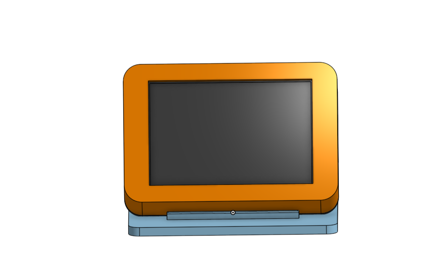
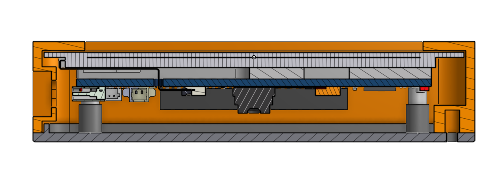

# Luna Desk

I wanted a small display for my desk that could show what my PC is doing and have some personality at the same time. Luna Desk combines live CPU and RAM readings, a clock, a focus timer, and Luna, a purple-haired robot character whose animation changes with CPU activity.

This is my **Hack Club Half Life, Week 4: Displays** project. I have built and tried the desktop preview, tested the serial sender with software loopback, compiled the ESP32-S3 firmware, and designed the enclosure and stand in Onshape. **I do not have the board yet: firmware upload, display and touch operation, USB communication with the board, and printed fit remain untested.**



## Current features

| Feature | Current implementation |
| --- | --- |
| PC dashboard | CPU and RAM percentages; firmware also has usage bars and a connection indicator |
| Clock | Local computer time; the firmware reads it from incoming messages |
| Character | Idle below 30% CPU; working at 30% or above |
| Focus timer | 25 minutes, start/pause and reset |
| Navigation | PC Status and Focus Timer views |
| Connection timeout | Firmware clears stale readings after 5 seconds without a valid stats message |
| Enclosure | Front shell, removable rear cover, USB opening, button windows, microSD access, and a separate 60° desk stand |

The Python preview is a desktop implementation of the interface, not an ESP32 emulator or an exact rendering of the LVGL layout. It reads the computer directly and does not send data to the board. `desktop/main.py` is the separate USB sender.

There are currently two character animations. Celebration animations, a separate character page, GPU/temperature readings, chatbot features, and real-time 3D rendering are not implemented. At timer completion the firmware stops at `00:00`; the preview also displays a completion message.

## Try it without hardware

Use Python 3 with Tkinter; development was done on Windows with Python 3.13. Run these commands in PowerShell from the repository root. Calling the virtual environment's Python directly avoids needing to activate it.

```powershell
py -m venv .venv
.\.venv\Scripts\python.exe -m pip install -r requirements.txt
.\.venv\Scripts\python.exe desktop\preview.py
```

In automatic mode Luna may stay idle while the computer is lightly loaded. To try the working animation while keeping real CPU and RAM readings:

```powershell
.\.venv\Scripts\python.exe desktop\preview.py --state working
```

Forced states are marked `(demo)`. `--state idle` forces idle; omitting the argument returns to live CPU selection. Pillow reconstructs GIF frames before Tkinter displays them, preventing partial-frame artifacts.

To print live statistics without a device:

```powershell
.\.venv\Scripts\python.exe desktop\main.py
```

To exercise serialization and the serial code using pySerial's software loopback:

```powershell
.\.venv\Scripts\python.exe desktop\main.py --port loop://
```

Successful packets print `Loopback matches: True`. This checks software round trips, not physical USB communication or the ESP32 parser. Stop the sender with **Ctrl+C**.

## Hardware and firmware

The intended board is the **Waveshare ESP32-S3-Touch-LCD-3.5B, SKU 31137**, the bare-board version without the manufacturer's case or camera. Its touchscreen is used in landscape at **480 × 320**. No custom PCB, battery, or microSD card is required for this version: animation frames are compiled into flash.

The sketch is [`firmware/LunaDesk/LunaDesk.ino`](firmware/LunaDesk/LunaDesk.ino). Follow the [firmware setup guide](firmware/LunaDesk/README.md) for dependency installation, pinned download links, and Arduino options. Development used Arduino IDE 2.3.10, Espressif Arduino-ESP32 3.3.10, Waveshare's bundled LVGL 9.2.2 and display/touch libraries, and ArduinoJson 7.4.2.

The selected board configuration is **ESP32S3 Dev Module**, **16 MB flash**, **OPI PSRAM**, **QIO flash**, **USB CDC On Boot enabled**, and the **16 MB flash / 3 MB application / 9 MB FATFS** partition option.

The last development compile reported **1,586,762 bytes of program storage (50% of the selected application partition)** and **91,060 bytes of global variables (27%)**. These are compiler figures, not measured animation performance or a complete runtime memory profile: display buffers are allocated in PSRAM at startup.

When the board is available, upload the sketch and close Serial Monitor so the sender can open the same port. Replace `COM3` with the actual Windows port:

```powershell
.\.venv\Scripts\python.exe desktop\main.py --port COM3
```

The sender uses **115200 baud**, sending approximately one UTF-8 JSON line per second. A representative packet is:

```json
{"type":"stats","version":1,"time":"2026-11-01T16:00:00-05:00","cpu_percent":35.0,"ram_percent":77.5,"ram_used_gib":12.4,"ram_total_gib":16.0,"state":"working"}
```

Each packet ends with a newline. Firmware validates the message type, version, and CPU/RAM ranges, then independently selects the character state from CPU usage. RAM quantities in GiB are sent but not displayed. A serial failure ends the sender; reconnect the device and restart the program rather than expecting automatic reconnection.

## Character assets

| Idle | Working |
| --- | --- |
|  |  |

Luna's source animation was generated for my custom ChatGPT Work mode companion. Short idle and working clips were extracted from that video, cropped to remove labels, and resized to **160 × 176**. The original pale background remains.

The desktop uses GIFs. Firmware uses full RGB565 frames in [`luna_sprites.h`](firmware/LunaDesk/luna_sprites.h), played by [`luna_character.h`](firmware/LunaDesk/luna_character.h). There are **9 idle and 8 working frames**, with a nominal 125 ms device frame interval. The raw firmware frames occupy **957,440 bytes** before other program data. Extraction parameters and the source video checksum are recorded in [`assets/character/source.json`](assets/character/source.json).

## Enclosure and stand

I designed the enclosure around the manufacturer's STEP model and checked its internal arrangement with section views. The shell and cover have a locating lip, four board mounting columns, and two separate closure bosses. The USB-side closure boss is offset to keep it away from the cable opening. Two ribs support the rear cover at 60° to the stand base; a lower stop retains the housing.

- [Editable Onshape document](https://cad.onshape.com/documents/b1627e067c1f0ce34a4ddbca/w/2b68315fab2d111fa0d9016e)
- [CAD files, printing notes and assembly instructions](cad/README.md)
- [Three-part assembly STEP](cad/step/luna_desk_assembly.step)

| Printed part | STEP | STL |
| --- | --- | --- |
| Front bezel / shell | [front_bezel.step](cad/step/front_bezel.step) | [front_bezel.stl](cad/stl/front_bezel.stl) |
| Rear cover | [rear_cover.step](cad/step/rear_cover.step) | [rear_cover.stl](cad/stl/rear_cover.stl) |
| Desk stand | [desk_stand.step](cad/step/desk_stand.step) | [desk_stand.stl](cad/stl/desk_stand.stl) |



The individual STEP files each contain one valid solid. Converted STLs were checked for closed meshes and consistent winding; [validation results](cad/validation.json) are included. These checks do not establish physical fit or an interference-free assembly. The STEP assembly includes only the three designed parts. Hardware in the section image is reference geometry, including an optional camera that is not required for Luna Desk.

## Parts and budget

| Planned item | Quantity | Notes |
| --- | --- | --- |
| Waveshare ESP32-S3-Touch-LCD-3.5B | 1 | Bare-board version, SKU 31137 |
| USB data cable | 1 | Check available cables before buying |
| Printed front shell, rear cover and stand | 1 each | Printing estimate pending |
| M2 × 10 mm screws | 4 | Board mounting through rear cover and columns |
| M2 × 6 mm screws | 2 | Rear cover to shell inserts |
| M2 heat-set inserts | 2 | Designed for Ruthex RX-M2x4 geometry |

Check actual thread engagement, insert fit and cable clearance before final assembly. No microSD card is needed for the compiled animation assets.

The [planning BOM](BOM.csv) now includes supplier links, whole purchase packs, the owned USB data cable, the three university-printed parts, and a **$5 provisional material allowance**. See [BOM notes and price sources](docs/bom-notes.md) for quantities, dated quotes, and the unverified insert-price estimate.

The **planning subtotal is $57.76**, including the earlier $11.20 Waveshare shipping quote and the $5 material reserve. Additional hardware shipping and checkout taxes are still unpriced. This leaves **$7.24** against the provisional $65 target; it is not a final delivered total or an approved grant. University printing/material fees remain unconfirmed, and the reserve is not a quotation for a whole filament spool.

## Validation and next steps

| Check | Status |
| --- | --- |
| Desktop statistics and animated preview | Tried on the development Windows PC |
| Software serial loopback | Matching transmitted and returned packets observed |
| ESP32-S3 firmware compilation | Successful in the development Arduino setup |
| CAD solids and converted STL mesh integrity | Checked; results included above |
| Firmware upload, display, touch mapping and animation performance | Pending board arrival |
| USB sender to board, timeout and reconnection | Pending board arrival |
| Printed assembly, screw clearance, cable boot, card access and stand stability | Pending printing and physical fit checks |

Next I need to receive the board, try the display and touch mapping, test the dashboard and timer on it, then print and adjust the enclosure. Development entries are mirrored into [`JOURNAL.md`](JOURNAL.md) from [Half Life](https://halflife.hackclub.com/projects/t65gnleisnhkmp3kfgijwwra); hours and entries must be logged on that platform.

## References and credits

- [Waveshare documentation](https://docs.waveshare.com/ESP32-S3-Touch-LCD-3.5B) and [example source](https://github.com/waveshareteam/ESP32-S3-Touch-LCD-3.5B): hardware information and the `10_lvgl_arduino_v9` display/touch starting point. The [manufacturer model package](https://files.waveshare.com/wiki/ESP32-S3-Touch-LCD-3.5B/ESP32-S3-Touch-LCD-3_5B.rar) supplied reference hardware geometry.
- [LVGL](https://github.com/lvgl/lvgl), [Arduino_GFX](https://github.com/moononournation/Arduino_GFX), [ArduinoJson](https://github.com/bblanchon/ArduinoJson), and Waveshare's bundled peripheral libraries support the firmware. Components retain their respective licenses; see [third-party notices](THIRD_PARTY_NOTICES.md).
- [psutil](https://github.com/giampaolo/psutil), [pySerial](https://github.com/pyserial/pyserial), [Pillow](https://github.com/python-pillow/Pillow), and Python/Tkinter support the desktop software.
- [Turing Smart Screen Python](https://github.com/mathoudebine/turing-smart-screen-python) inspired the idea of displaying PC information on a small screen; its display driver is not used here.
- Luna's artwork and source animation were generated for my custom ChatGPT Work mode companion; this project's two states use excerpts from that video.

Project by **Nash Andrés Rivera Ramírez**.
