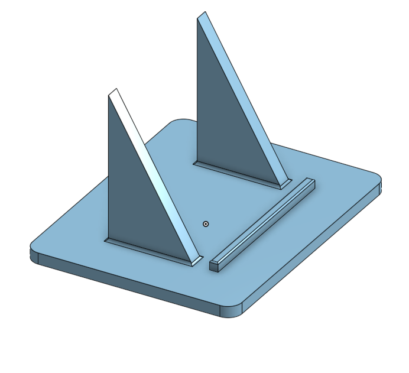

# Luna Desk CAD

Designed in Onshape by Nash Andrés Rivera Ramírez around Waveshare's ESP32-S3-Touch-LCD-3.5B reference model. These are unprinted prototypes.

[Editable Onshape document](https://cad.onshape.com/documents/b1627e067c1f0ce34a4ddbca/w/2b68315fab2d111fa0d9016e)

| Part | STEP | STL | Quantity |
| --- | --- | --- | --- |
| Front shell / bezel | [front_bezel.step](step/front_bezel.step) | [front_bezel.stl](stl/front_bezel.stl) | 1 |
| Rear cover | [rear_cover.step](step/rear_cover.step) | [rear_cover.stl](stl/rear_cover.stl) | 1 |
| Desk stand | [desk_stand.step](step/desk_stand.step) | [desk_stand.stl](stl/desk_stand.stl) | 1 |

[luna_desk_assembly.step](step/luna_desk_assembly.step) contains these three parts in their assembly positions, without electronics. Individual STEP files preserve their original export coordinates. Import STLs as **millimeters**, orienting parts individually in the slicer.

The shell is 65.8 × 97.24 mm across its front and 20 mm deep. The rear plate is 2 mm thick; its mounting columns make its overall bounding-box depth 8.2 mm. The stand base is 95 × 75 × 4 mm, with ribs at 60° to the base and a lower stop adjusted against the assembled case.

## Planned assembly

1. Trial-fit the empty printed parts, locating lip and access openings.
2. Install two M2 heat-set inserts in the shell's closure bosses. The design uses **Ruthex RX-M2x4 geometry**: 4 mm length, 3.6 mm outer diameter, 3.2 mm pilot holes and 5 mm blind hole depth. Confirm actual inserts and printer tolerances; other M2 inserts may require different holes.
3. Seat the display in the shell, checking the modeled glass clearance against the actual unit. Keep hard edges from pressing on the active display.
4. Align the rear cover's four columns with the existing metal M2 board mounting points. Four planned **M2 × 10 mm** screws pass through the 2 mm plate and 6.2 mm columns, leaving about 1.8 mm thread engagement. Confirm actual available thread depth before tightening.
5. Close the shell with two **M2 × 6 mm** screws through the cover into the inserts. Check for bottoming out.
6. Rest the landscape enclosure on the stand, buttons and microSD uppermost. Check that screw heads clear both ribs and that the stop retains the housing.

Button access windows are included, but printed button plungers are not. An optional camera appears in the manufacturer's reference model; Luna Desk does not require one or a camera opening.

## Printing and checks

PLA is a proposed starting material, not a tested choice. Begin slicing the cover with its exterior face down and columns up, and the stand with its flat base down. Inspect the shell's bezel, internal bosses, access-window bridges and support requirements before deciding its print orientation. No printer profile, material consumption or support-free result has been validated.

STLs were generated from the supplied individual STEP files with CadQuery/OpenCascade using 0.05 mm linear and 0.1 rad angular tessellation tolerances. Each STEP is one valid solid; each STL is one closed component with consistent winding. Results: [validation.json](validation.json). Tessellation tolerance is not a physical assembly allowance.

Still required: physical trial fit, screw and insert engagement, USB cable boot clearance, microSD removal, button reach, screen operation, and stability while touching the screen or pulling the cable. Mesh integrity does not certify mechanical clearances.

Reference: [official Waveshare model package](https://files.waveshare.com/wiki/ESP32-S3-Touch-LCD-3.5B/ESP32-S3-Touch-LCD-3_5B.rar). This folder does not redistribute the full board model.
